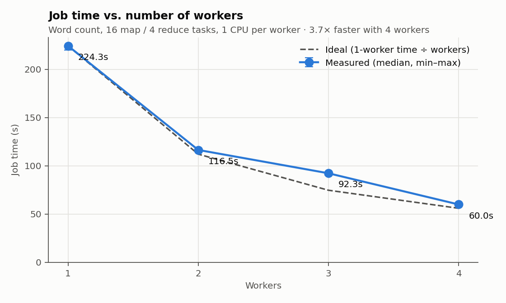
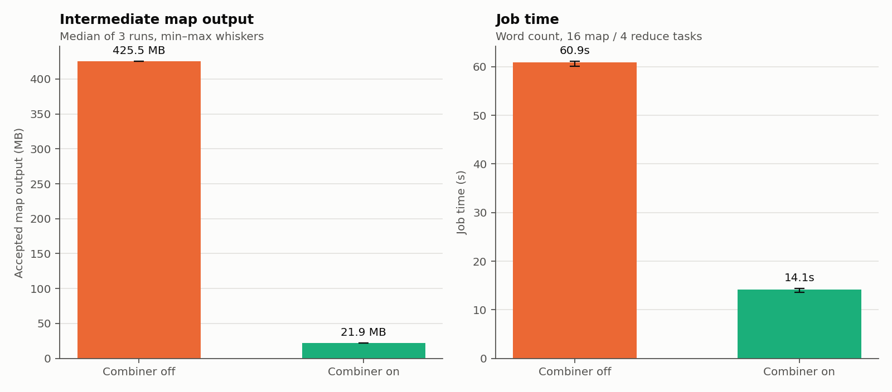
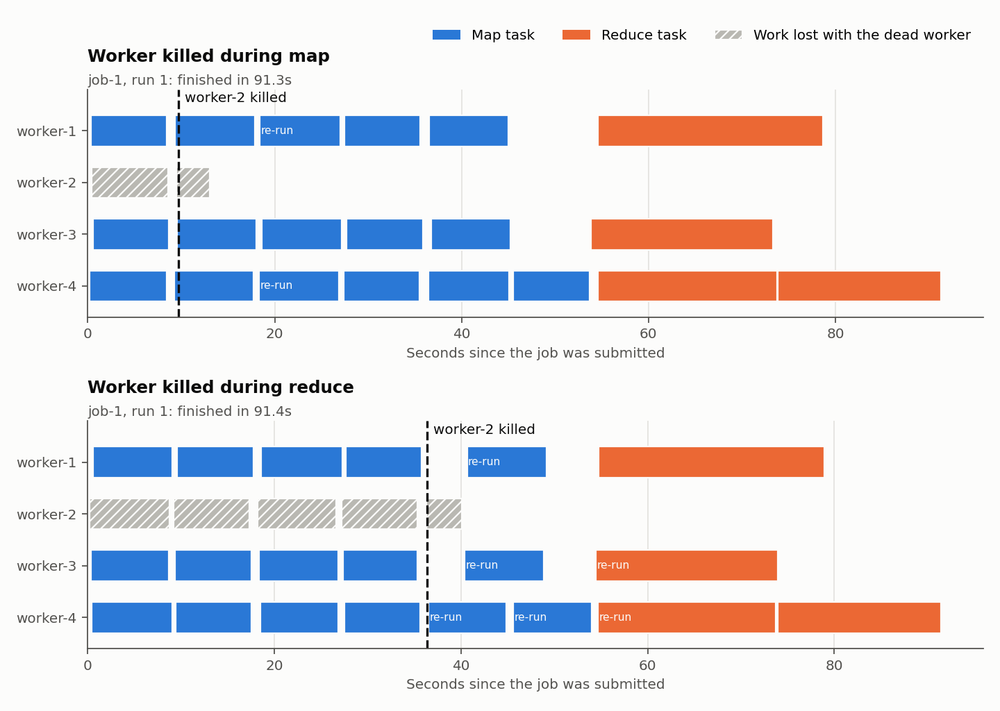
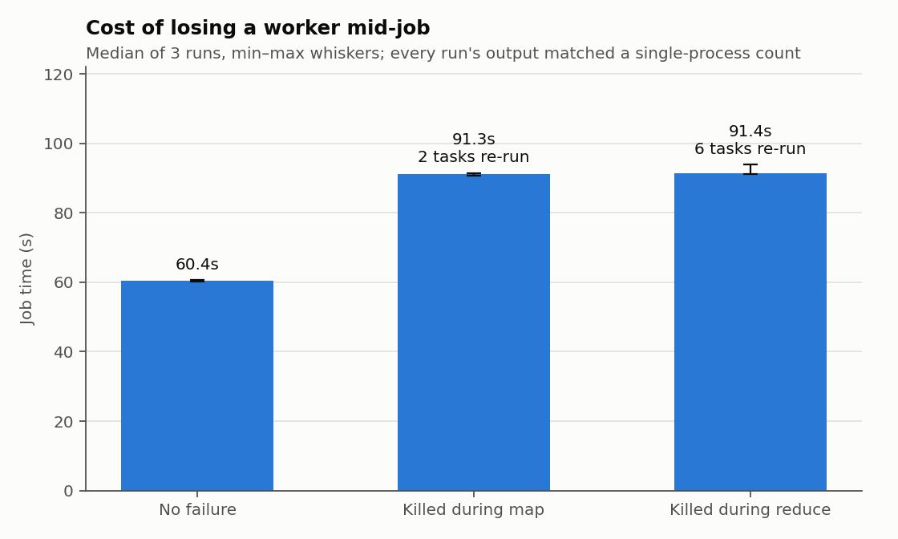
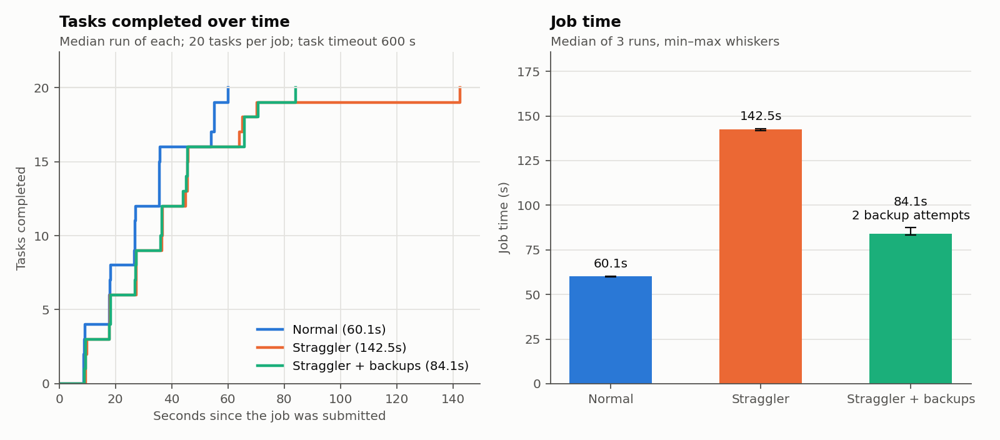

# cs544-mapreduce

A MapReduce system modeled on Dean & Ghemawat (OSDI '04), running on Docker
Compose: one **boss** and four **workers** (1 CPU each), plus a **client** on
the host that uploads data, submits jobs and reads the output.

CS 544 Honors Project 1, UW-Madison, Fall 2026 — Rameez Rahaman (`rrameez99`)
and Rohan Sohoni (`RS0H0NI`).

Special features:

1. **Combiners**: optional map-side partial reduction, to shrink the shuffle.
2. **Worker-failure handling**: heartbeats and task timeouts detect dead or
   stuck workers; their running tasks, and their finished map output, are
   re-run elsewhere and the job still produces the correct output.
3. **Backup tasks for stragglers** (paper §3.6): near the end of each phase,
   idle workers run backup copies of the last running tasks; the first copy
   to finish wins.

The full design, including the reasoning behind each decision, is in
[design.md](design.md). This README covers how to run everything.

---

## Contents

- [Quick start](#quick-start)
- [Using the client](#using-the-client)
- [Writing a job](#writing-a-job)
- [How it works](#how-it-works)
- [Trying the special features](#trying-the-special-features)
- [Tests](#tests)
- [Performance evaluation](#performance-evaluation)
- [Repository layout](#repository-layout)
- [Differences from design.md](#differences-from-designmd)

## Quick start

You need Docker with the Compose plugin and Python 3.12 on the host. Run
everything from the repository root.

```bash
# 1. Host tools: the client, the tests and the evaluation scripts
python -m venv .venv
source .venv/bin/activate          # Windows: .venv\Scripts\Activate.ps1
pip install -r requirements-dev.txt
python scripts/gen_protos.py       # protobuf stubs are generated, not committed

# 2. Build the image and start the boss and four workers
docker compose up -d --build
docker compose logs boss | grep "live workers"   # wait for all four workers

# 3. Upload some text, run word count, and look at the result
python -m client upload path/to/books /input/books
python -m client submit --input /input/books --output /output/wc \
    --job examples/wordcount.py --maps 8 --reduces 4
python -m client status job-1 --wait
python -m client cat /output/wc | sort -k2 -nr | head

# 4. Stop the cluster
docker compose down
```

Any folder of UTF-8 text files works as input. The evaluation uses the dataset
described in [Performance evaluation](#performance-evaluation).

## Using the client

The client runs on the host, not in a container. `./shared` on the host is
mounted at `/shared` in every container, so the client stages input by copying
files there and reads output from there. Client paths are relative to that
folder: `/input/books` means `./shared/input/books` on the host and
`/shared/input/books` inside the containers.

| Command | What it does |
|---|---|
| `python -m client upload <host path> <shared path>` | Copies a file or folder into shared storage. Refuses to overwrite an existing path. |
| `python -m client submit --input P --output P --job FILE --maps M --reduces R [--combiner] [--backup-tasks]` | Sends the job file's code and settings to the boss and prints the new job ID. The output folder must not exist yet. |
| `python -m client status <job id> [--wait]` | Prints the job's state and how many map and reduce tasks are done. `--wait` polls every second until the job succeeds or fails (and exits with 1 if it failed). |
| `python -m client cat <shared path>` | Prints the final `part-r-*` files in reducer order. It skips the job's `_events.jsonl` log and any temporary files. |

The boss listens on `localhost:5440`.

## Writing a job

A job is a single Python file with `map` and `reduce` generator functions, and
optionally `combine`:

```python
# examples/wordcount.py
def map(key, line):            # key = (file path, byte offset), line = one line of text
    for word in line.split():
        yield word.lower(), 1

def combine(key, values):      # optional; used only with --combiner
    yield key, sum(values)

def reduce(key, values):       # values: every value emitted for key, from all mappers
    yield key, sum(values)
```

- Intermediate keys must be strings, and values must be JSON-serializable.
- Each reduce output pair becomes one line `key<TAB>value` in
  `part-r-NNNNN`, where `NNNNN` is the reduce task's number.
- The client sends the file's contents with the job; workers load a fresh
  copy for every task attempt. Nothing needs to be installed in the image.
- If the job raises an exception, or yields something invalid, that attempt
  fails and the task is retried on another worker. After 3 failures the job
  fails with the error message, which `status` prints.

## How it works

```
 host:  python -m client ──gRPC──► boss (localhost:5440)
          │ copies files            ▲  Register / Heartbeat (+ task) / ReportTaskDone
          ▼                         │
   ./shared  ═══ mounted at /shared in every container (job input and output)
                                    │
     worker-1   worker-2   worker-3   worker-4      1 CPU each
      /local     /local     /local     /local       intermediate files stay on local disk
        └────── FetchPartition (worker-to-worker gRPC) ──────┘
```

1. **Submit.** The boss splits the input bytes into `--maps` ranges, adjusted
   to line boundaries, and creates `--reduces` reduce tasks.
2. **Map.** Workers *pull* work: each 1-second heartbeat to the boss can come
   back with a task. A map task writes one file per reduce partition to its
   worker's `/local` disk, using `crc32(key) % R` as the partitioner (not
   Python's `hash()`, which differs between processes).
3. **Reduce.** Once every map is done, each reduce task fetches its partition
   from every mapper over gRPC, sorts and groups by key, and runs `reduce`.
4. **Commit.** A reduce attempt writes to its own temporary file, `fsync`s it,
   and atomically renames it to `part-r-NNNNN`. If two attempts of the same
   task both finish, the output still holds exactly one complete copy, and the
   boss accepts only the first report.

Every task assignment is a new **attempt** with its own ID, which is what makes
re-runs, timeouts and backup tasks safe to run side by side. Details:
design.md §3–§6.

**Event log.** For every job, the boss writes
`<output>/_events.jsonl`: one JSON line per event (job submitted, attempt
started with its reason — first, re-run, timeout or backup — attempt finished,
failed or lost, map output lost, job finished), with `t` = seconds since
submission. All of the evaluation plots are built from these logs.

## Trying the special features

**Combiner.** Add `--combiner` to `submit`. The job file must define
`combine`. Compare `bytes_written` for map attempts in the two runs'
`_events.jsonl` files.

**Worker failure.** Start a larger job and kill a worker partway through:

```bash
python -m client submit --input /input/books --output /output/wc-failure \
    --job examples/wordcount.py --maps 16 --reduces 4
docker compose kill worker-2        # like pulling the plug
python -m client status job-2 --wait
docker compose logs boss | tail     # "marking it dead", then re-runs
```

The boss marks `worker-2` dead after 3 s without a heartbeat. Its running
attempts go back to the queue, and so do its *finished* map tasks while any
reduce still needs them, because their output was on `worker-2`'s disk (paper
§3.3). A task that hangs instead of dying is re-run after a 30 s timeout. A
reducer that can't fetch a partition reports it, and the boss re-runs that map
task. `docker compose up -d worker-2` brings the worker back; it starts with an
empty `/local` and registers again.

**Backup tasks.** Make `worker-4` a straggler with 0.2 CPUs, then run the same
job with and without `--backup-tasks`:

```bash
docker compose -f docker-compose.yml -f docker-compose.straggler.yml up -d
python -m client submit --input /input/books --output /output/wc-slow \
    --job examples/wordcount.py --maps 16 --reduces 4
python -m client submit --input /input/books --output /output/wc-backup \
    --job examples/wordcount.py --maps 16 --reduces 4 --backup-tasks
```

Once every task of a phase has started and at most 10% (at least one) are
unfinished, idle workers get one backup copy each of the longest-running tasks,
never on the worker already running that task. Backup attempts show up in the
event log with `"reason": "backup"`.

## Tests

```bash
pytest -q
```

The unit tests cover the scheduler (task states, attempts, duplicates,
timeouts, dead workers, backup tasks), the worker (input splits, partitioning,
combiner, the output commit, fetching), the boss and worker RPCs, the client,
and the evaluation code. They need no cluster and use fake clocks, so they run
in a few seconds. GitHub Actions runs them on every pull request and on `main`,
and every pull request is reviewed by the other teammate before it merges.

The end-to-end checks happen in the evaluation: every experiment run below is
a real job on the cluster, and its output is compared with a single-process
run of the same job code before its results are kept.

## Performance evaluation

The reproducible input is approximately 200 MiB of repeated public-domain
Project Gutenberg text. Download the plain-text UTF-8 editions of
[*Frankenstein* (eBook #84)](https://www.gutenberg.org/cache/epub/84/pg84.txt)
and [*Adventures of Sherlock Holmes* (eBook #48320)](https://www.gutenberg.org/cache/epub/48320/pg48320.txt),
then create the dataset:

```bash
mkdir -p books
curl -L https://www.gutenberg.org/cache/epub/84/pg84.txt -o books/frankenstein.txt
curl -L https://www.gutenberg.org/cache/epub/48320/pg48320.txt -o books/sherlock-holmes.txt
python scripts/make_data.py books/frankenstein.txt books/sherlock-holmes.txt
```

`make_data.py` sorts the source paths, verifies UTF-8, makes every input end
on a line boundary, and repeats the complete combined corpus until it reaches
200 MiB. It writes `shared/input/books/books.txt`, which the harness uses as
`/shared/input/books`.

Each experiment starts a fresh cluster for every run, submits the job through
gRPC, waits for it, checks the output against a single-process run of the job,
and copies the job's event log into `eval/results/<experiment>/`. The plots are
drawn only from those saved logs, so they can be redrawn without rerunning
anything. Each configuration runs 3 times; the plots show the median with
min–max whiskers.

Run the experiments on the VM (4 CPUs), after building the image and creating
the dataset:

```bash
docker compose build
python -m eval.scaling run      # plot 1
python -m eval.combiner run     # plot 2
python -m eval.failures run     # plots 3 and 4
python -m eval.backup run       # plot 5

python -m eval.scaling plot
python -m eval.combiner plot
python -m eval.failures plot
python -m eval.backup plot
```

### 1. Scaling: job time vs. number of workers



The same job (16 maps, 4 reduces) with 1 to 4 workers, against ideal linear
speedup. Each worker is limited to 1 CPU, so speedup comes only from spreading
tasks across workers.

### 2. Combiner



Word count with and without the map-side `combine` function. The left panel
shows bytes written by accepted map attempts, and the right panel shows total
job time. Each configuration has three fresh-cluster runs; bars are medians
and whiskers show the minimum and maximum. Each run's raw event log and
metadata live in `eval/results/combiner/`, so the figure can be redrawn and
inspected without re-running the cluster.

### 3. Failure timeline



Every task attempt as a bar on the worker that ran it, with `worker-2` killed
during the map phase (top) and the reduce phase (bottom). Hatched gray bars are
work lost with the dead worker, including finished map tasks whose output was
on its disk; the other workers re-run them. The harness only kills `worker-2`
while it is running a task of that phase, and checks the event log afterwards
to confirm that work was actually lost.

### 4. Cost of a failure



Job time with no failure, a worker killed during map, and a worker killed
during reduce, with how many tasks had to be re-run.

### 5. Backup tasks (like Figure 3 of the paper)



Tasks completed over time with four healthy workers, with `worker-4` slowed to
0.2 CPUs, and with the same straggler plus backup tasks.

## Repository layout

```
boss/        server.py (gRPC service, liveness checks), jobs.py (scheduler: tasks,
             attempts, timeouts, re-runs, backups), workers.py (registry), events.py
worker/      server.py (heartbeat loop, FetchPartition), runner.py (map/reduce,
             combiner, partitioner, commit), storage.py, job_code.py (loads the job)
client/      cli.py (upload, submit, status, cat)
protos/      mapreduce.proto; stubs are generated by scripts/gen_protos.py
common/      env.py (required environment variables)
eval/        harness.py (runs jobs on the cluster), analysis.py (event logs → numbers),
             scaling.py, combiner.py, failures.py, backup.py, style.py, results/, plots/
examples/    wordcount.py
tests/       pytest unit tests
Dockerfile, docker-compose.yml, docker-compose.straggler.yml
.github/workflows/ci.yml
```

## Differences from design.md

design.md was written before the code and is kept as the record of the plan.
Where the code ended up differing:

- **Evaluation layout.** Instead of one `eval/plots.py` and a
  `results.csv`, each experiment has its own script with `run` and `plot`
  commands, and results are kept as the raw per-run event logs plus a
  `runs.json` per experiment.
- **End-to-end and fault-injection testing** run through the evaluation harness
  on the VM rather than in GitHub Actions; CI runs the unit tests. Every
  evaluation run checks its output, including the runs with a killed worker.
- **One Dockerfile** for both the boss and the workers; Compose picks the
  command for each container. The proto folder is `protos/`.
- **Restarted workers start clean.** A worker clears its `/local` folder
  before registering, since job IDs start again at `job-1` when the boss
  restarts.
